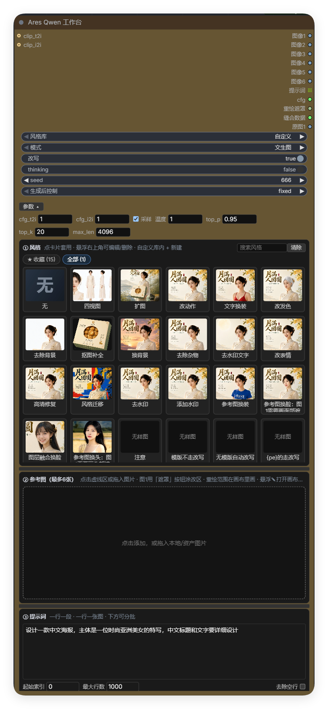
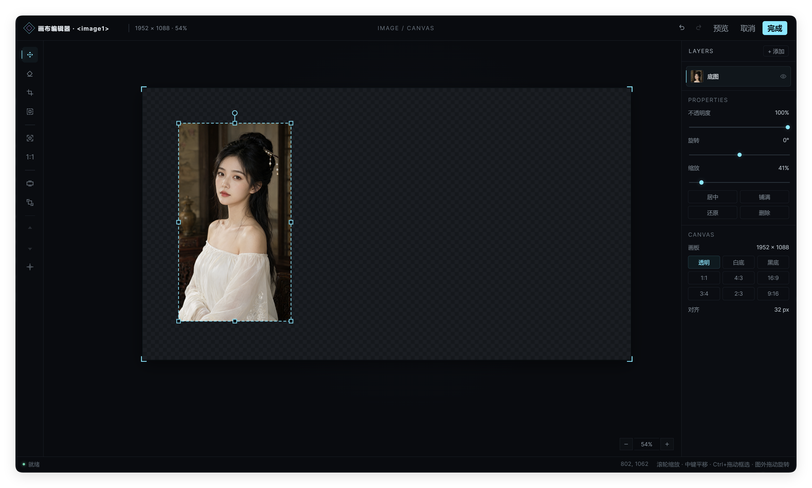

# Ares Qwen 工作台 — Qwen-Image-2.1 全流程装配节点（ComfyUI 定制版）

**简体中文** · [English](README.en.md)

   

**当前版本 v1.01**（2026-10-13）

一个节点完成 Qwen-Image-2.1 出图前的全部装配——风格模板、参考图（画布编辑 / 遮罩标注 / 裁剪重绘）、按行批量提示词，可选经 PE（提示词改写模型）逐行改写后输出。附带交互式 3D 姿态工作室，一站式出控制图。

> **兼容性**：经实测，本插件完全兼容 **Flux 3**。

## 界面一览

**工作台** — 风格库 / 参考图 / 批量提示词一屏装配，3941 条风格带真实出图缩略图



**画布编辑器** — 多图层合成 / PS 式 8 向手柄 / 比例预设 / 对齐 32，图层文档按卡保存



## 节点一览

| 节点 | node id | 用途 |
|---|---|---|
| Ares Qwen 工作台 | `AresQwenWorkbench` | 全功能装配台（风格 / 参考图 / 遮罩 / 裁剪重绘 / 批量） |
| Ares 文本增强 | `AresTextEnhance` | 纯 PE 改写：prompt 进 → rewritten_prompt + cfg 出（老工作流兼容） |
| Ares 多样性增强 | `AresQwenSeedVariance` | 文本嵌入注入结构化噪声，缓解同提示词人脸趋同 |
| Ares 局部缝合 | `AresInpaintStitch` | 把裁剪区的采样结果按羽化掩膜缝回原图（配合工作台裁剪重绘） |
| Ares Pose Studio | `Ares_PoseStudio`（分类 `Ares/pose`） | 交互式 3D 姿态工作室：体型滑块、多姿态、动画时间线、SAM 3D 图片转姿态、Mixamo FBX、姿态库，出控制图（mesh / canny / soft_edge / lineart / depth / openpose）与相机提示词 |

工作台、文本增强、多样性增强、局部缝合走 `comfy_entrypoint`（新式）注册；Pose Studio 在 `pose_studio/` + `web/pose_studio/`，与 ComfyUI_VNCCS_Utils 原插件可并存。

## 功能特性

### 工作台面板

```
风格库   ← 切换大类（下拉）
模式     ← 文生图 / 图片编辑
改写     ← PE 开关
thinking ← PE 推理时是否先思考再出 JSON（质量更好、更慢）
seed     ← 留空每行随机；填写各行同种子复现
① 风格  ② 参考图  ③ 提示词（工作台 UI）
```

**高级参数**（右键节点 → Show Advanced 展开）：
`cfg_t2i` / `cfg_i2i`（cfg 输出口的推荐值）、`do_sample` / `temperature` / `top_p` / `top_k`（PE 采样，官方默认）、`max_length`（PE 生成上限，默认 4096）。

### 输出口

| 输出口 | 接到 |
|---|---|
| 图像1~6 | `TextEncodeQwenImage21` 的 image_1~6 |
| 提示词 | 它的 prompt（PE 改写后的文本，每行一条，输出为列表） |
| cfg | 采样器 cfg（随模式自动切换推荐值） |
| 重绘遮罩 | 局部编辑的羽化遮罩：裁剪重绘=裁剪区尺寸、红罩模式=整图分辨率（接 Set Latent Noise Mask 限制重绘范围）；未画遮罩时为空 |
| 缝合数据 | 接「Ares 局部缝合」节点，把采样结果缝回完整原图；未启用裁剪重绘时为空 |
| 原图1 | 图 1 加载时的原始完整图（未裁剪、未叠红罩），接对比节点当基准 |

### 模式行为

**文生图**：风格模板整段注入（整图描述），PE 按 T2I 协议改写；可关闭改写原样直出。

**图片编辑**：风格分三形——

- **描述型**（无 `{prompt}` 的外观模板）：派生为「渲染风格（范围自动限定）+ 编辑要求」结构，PE 融合改写；
- **指令型**（含 `{prompt}` 的操作模板，如四视图/改动作）：约束骨架 + 提示词栏内容原位替换后**直出**，不经 PE；
- **`{pe}` 种子型**（指令末尾带 `{pe}` 标记）：同指令型组装，但整体交 PE 做图像锚定改写——模板管约束完整性，PE 管按实际图片细化，对换脸/换头等精细任务显著更好。

**自动规则**：行内含 透明 / 抠图 / 去背景 / PNG 等关键词时自动跳过 PE（PE 会丢失透明要求）；参考图输出按源文件自动 RGB / RGBA。

### PE 改写引擎（官方 PE 模型的使用与改进）

直接采用 **Qwen 官方 PE 权重**（`qwen3.5_9b_qwen_image_2.1_pe` T2I / I2I），不做任何再训练，在其上做了全套工程化改进：

- **双权重自动换入换出**：T2I / I2I 两个官方权重按当前模式只加载用到的那个，另一个自动移回内存——省显存，切模式零操作
- **图像锚定改写（`{pe}` 种子型）**：突破纯文本输入，让 I2I 权重结合实际参考图细化改写——模板管约束完整性，PE 管按真实图片细化，换脸 / 换头等精细任务显著更好
- **thinking 开关**：PE 先推理再出 JSON（质量更好、更慢），按需关闭提速
- **透明保护**：行内含 透明 / 抠图 / 去背景 / PNG 等关键词自动跳过 PE——官方 PE 会丢失透明要求，这里自动兜住
- **失败兜底**：PE 解析失败自动回退原文，不炸队列
- **即插即换**：社区 Heretic（消融拒绝）版本格式相同，直接替换文件即用

### 风格库

- 3941 条风格，12 大类：3D渲染 / 动漫 / 卡通 / 实验 / 封面艺术 / 摄影 / 氛围 / 漫画 / 素描 / 绘画 / 设计 / 其他；大类内按子分类标签浏览，每页 120 张 + 显示更多；
- **来源**：母本为 Krea 官方公开 moodboard 目录（画廊页 https://www.krea.ai/app?gallery=moodboards ，单板页格式 `krea.ai/moodboard-feed/<slug>`）——与 ComfyUI-Krea-Moodboards 插件自带的完整目录爬取（3549 条）标题精确匹配约 89.5%，并沿用其消重命名格式（"标题 — 风格限定词"）；另约 400 条为库外补充/自定义。加工形态为关键词串 + `Subject:{prompt}`，配中文名与本地 webp 缩略图；
- 搜索框：全库全局搜索（中英文名 / prompt 内容 / 库名 / 子分类名），支持多词与模糊匹配；
- **自定义**（默认库）：23 条常用编辑模板——四视图 / 扩图 / 改动作 / 文字换装 / 改发色 / 改表情 / 去除背景 / 抠图补全 / 换背景 / 去除杂物 / 去水印 / 去水印文字 / 高清修复 / 风格迁移 / 添加水印 / 参考图换装 / 参考图换脸 / 图层融合换脸 / **参考图换头** 等，卡片悬浮 ✎ 编辑 / ✕ 删除，「+」新建（预览图自动转存 webp）；
- **收藏**：风格卡悬浮时左上角 ☆/★ 一键收藏（已收藏常显金星）；子分类标签行的「★ 收藏」标签跨库列出所有收藏（按收藏时间倒序，点卡片自动切到对应库）。收藏存在 ComfyUI 根目录 `ares_style_favorites.json`，跟随 ComfyUI 而非浏览器；
- 每条风格带真实出图缩略图（全库 webp 格式）。

### 参考图

- 最多 6 张，按 `<image1~6>` 顺序引用；任意尺寸（下游自动对齐 32 倍数），带透明的 PNG 原样保留 RGBA；
  - **6 张足够，不需要更多**：得益于画布编辑器的图层功能，多元素素材不必各占一张卡——全部作为图层叠进图 1 的合成画布（多图层摆位 / 8 向手柄 / 图层文档按卡保存），一次合成、一张装下；
- 卡片可拖拽换位（调整 `<imageN>` 编号）、悬停看大图（透明区显示棋盘格）；
- ↩ 还原原图（编辑过才出现，历史随工作流保存）；
- **每张卡的画布编辑器互相独立**（卡片悬浮 ✎）：
  - **图 1** = 合成画布：多图层摆位、扩板、多元素构图，出图写回图 1；
  - **图 2~6** = 独立编辑该图本身：抠图 / 擦背景 / 裁切等纯参考图预处理，出图写回该卡，不并入图 1。

### 遮罩标注（卡片「遮罩」按钮）

**遮罩只对第 1 张参考图生效。**语言难以定位的修改目标用它。

- 图 1 卡片下方点 **「遮罩」/「改遮罩」** 按钮 → 打开 ComfyUI **原生遮罩编辑器**（建临时节点，不污染工作流），涂抹要修改的区域后点保存；
- 保存后自动把笔触转成黑白遮罩 PNG 写回卡片，缩略图叠**红罩预览** + 蓝色「遮罩」角标；**「清罩」**按钮一键清除；
- 运行时遮罩区叠半透明红色烧进图 1 给模型看（软混合、羽化边缘渐变），提示词自动追加「只修改遮罩区域」的范围说明；遮罩覆盖近全图或近空时按整图编辑、不叠红罩；
- 遮罩参与生成的同时输出**重绘遮罩**口（整图分辨率羽化遮罩，可接 Set Latent Noise Mask 或预览）；
- 画板尺寸变化后原遮罩必然错位，自动清除并提示重画；
- 与任何模板 / PE 组合兼容。

### 裁剪重绘（画布圈选重绘范围）

图 1 在画布编辑器里用**「重绘范围」工具框选裁切区域**时启用。目的是把采样量从整图降到局部、且范围外像素由缝合保证逐位不变。

- **圈选即遮罩**：框内=重绘、框外=保持原样，不需要再画遮罩；
- **遮罩∩框选**：卡片上另画了遮罩时，取遮罩限制在框选范围内——框选定大致区域，遮罩精细限定框内哪些部分重画（两者不相交时按整幅遮罩处理并告警）；
- **裁剪区 = 有效重绘区外接框的正方形边界 × 上下文系数**（绕物体中心、只扩不拉、比例不变）；图像1 输出**干净裁剪图**（不含任何标注，下游 `TextEncodeQwenImage21` 的 image_1 与 VAE Encode 都接它；要给 TextEncode 支路加视觉标注，在图 1→TextEncode 线上挂 DrawMaskOnImage 之类节点）；
- **采样分辨率自动适配物体大小**：裁剪方形 <512 放大到 512、>2048 缩到 2048、中间原尺寸，比例不变，对齐 32；
- **Ares 局部缝合**节点把 VAE Decode 结果还原到裁剪区尺寸，按扩边 + 高斯羽化的掩膜与原图混合缝回——掩膜外像素逐位不变，缝合数据为空时直通输出（可常驻接线）；
- **缝合羽化**（过渡带宽度，默认 32px）与**上下文系数**（默认 ×1.2）在画布「重绘范围」工具的侧栏里调，随框选范围按卡保存；
- 重绘遮罩与缝合掩膜都带羽化（遮罩外扩羽化 + 高斯过渡），边缘平滑无硬接缝；批量逐行采样共用同一裁剪与缝合数据；
- 只标注不画进导出图。

### 画布编辑器

每张卡一块独立文档的画布（iframe + 原生 canvas，非主界面 DOM）。走 iframe 是因为绘制事件与 ComfyUI 主界面完全隔离，8192 级画布不因宿主重排掉帧。

| 概念 | 行为 |
|---|---|
| **画板** | 独立尺寸（初始 = 该图尺寸），可加大也可裁小；对齐 32 的倍数（64~8192）；比例预设（1:1 / 4:3 / 16:9 / 3:4 / 2:3 / 9:16，宽不变按比例算高）或对话框手填；八向拖拽手柄改尺寸——拖哪个边哪个角跟手，对侧不动 |
| **视图** | 滚轮缩放（光标为中心）、中键按住拖拽平移（左键+空格同效）。**只改视野，不动图像数据** |
| **选图** | 画布上**直接点图即选中**（多层重叠取最上层）；点空白取消选中 |
| **图层** | 框内拖动移动；PS 式 8 向手柄缩放（四角等比 / 四边单向）；**图外任意位置按住拖动 = 绕中心旋转**（近 15° 自动吸附，按 Shift 取消）；图层列表可显隐 / 删除 / 拖拽排序 |
| **多选** | **Ctrl+左键拖动框选**；Ctrl+单击加 / 减选；多选时合并包围盒上出整组手柄——拖动整体平移、手柄整组缩放 / 旋转（各层保持相对位置）；普通单击收拢回单选 |
| **橡皮** | 大小 2~256px、边缘羽化 0~100% 可调，笔刷圈跟随光标；只擦当前选中图层的像素 |
| **裁切** | 框选当前图层的区域（框外压暗），双击 / 回车 / 按钮应用；保留旋转，不裁出图外，一步可撤销 |
| **重绘范围** | 仅图 1 画布：框选局部重绘的裁切范围（自动对齐 32），配缝合羽化 / 上下文系数侧栏，见「裁剪重绘」 |
| **扩板** | 「扩张到图层」把画板扩到刚好容纳所有内容；**空出来的画板区域保持透明** —— 配「扩图」或「图层融合」模板跑即为扩图任务 |
| **导出** | 按画板原始尺寸渲染 PNG（画板外透明）→ 上传写回当前卡 |

**图层记忆**：编辑结果以「图层文档」**按卡保存**（画板尺寸 + 每层的图源 / 位置 / 尺寸 / 旋转 / 不透明度 / 显隐 + 重绘范围）。下次进入同一张卡时**原样还原全部图层**，二次编辑不会退化成一张扁平图。卡上的图片回退原图（↩）或重排后换图时，该卡文档作废。

### 换脸 / 换头 SOP

**路线一：纯参考图（推荐）**

1. 脸/头源卡（第 2 张起）点 ✎ 独立编辑：抠图、擦掉背景杂物，出图写回该卡；
2. 直接配「参考图换脸」或「参考图换头」模板（`{pe}`）跑——脸/头的位置几何、光照、身体全部来自图 1，外观来自图 2。

**路线二：画布合成**

1. 图 1 点 ✎ 进合成画布，「+ 添加」选脸源文件，摆位对位（拖动 / 8 向手柄 / 图外旋转），需要时改画板尺寸；
2. 应用 → 合成图替换第 1 张；配「图层融合」模板（`{pe}`）跑；
3. 需要更强空间锁再在图 1 卡片上补遮罩。

> 对齐精度：2.1 原版模型（50 步、无蒸馏 LoRA）编辑是像素级对齐的；4 步蒸馏 LoRA 提速但会带来几何漂移——对位置要求高的任务关 LoRA。

### 批量

提示词一行一段；`起始索引 / 最大行数 / 去除空行` 控制本次跑哪几行；下游逐条执行，一行一张图；参考图对每行复用。

**外部文本接入**：节点左侧的「提示词接入」口可接任意 STRING 输出（文本节点 / LLM / 其他插件）。接上后以连线文本为准（空串也算），提示词框自动置灰只读；断开后恢复用框内文字。分批规则、风格、PE 改写对两种来源一致。

## 安装步骤（ComfyUI custom_nodes）

1. **克隆到 ComfyUI 的 custom_nodes 目录**
   ```
   cd ComfyUI/custom_nodes
   git clone https://github.com/SuperWJ062/ComfyUI_Ares_Qwen-Image-2.1_Workbench.git
   ```
2. **安装依赖**（用 ComfyUI 自带 Python 环境）：
   ```
   ComfyUI/python/python.exe -m pip install -r ComfyUI_Ares_Qwen-Image-2.1_Workbench/requirements.txt
   ```
3. **重启 ComfyUI**，节点分类 `Ares` / `Ares/pose` 下可找到全部节点。

## 模型下载（PE 改写权重）

PE 权重放 `models/text_encoders/`，`CLIPLoader`（type=qwen_image）加载：

| 用途 | 文件 |
|---|---|
| T2I 改写 | `qwen3.5_9b_qwen_image_2.1_pe_t2i.int8_convrot.safetensors` |
| I2I 改写 | `qwen3.5_9b_qwen_image_2.1_pe_i2i.int8_convrot.safetensors` |

**官方下载地址**

| 来源 | 地址 | 说明 |
|---|---|---|
| Qwen 官方 PE 原始仓库 | https://huggingface.co/Qwen/Qwen-Image-2.1-PE-T2I · https://huggingface.co/Qwen/Qwen-Image-2.1-PE-I2I | 官方原始发布（本文件的出处） |
| Comfy-Org 重打包仓库 | https://huggingface.co/Comfy-Org/Qwen-Image-2.1 | `text_encoders/` 目录，上表 int8_convrot 文件即出自此仓（9.47GB/个，附带 SHA256 校验） |
| 主模型 / Turbo | https://huggingface.co/Comfy-Org/Qwen-Image-2.1/tree/main/diffusion_models | `diffusion_models/` 目录，示例工作流所用最新 Turbo 模型在此 |
| 基座模型 | https://huggingface.co/Qwen/Qwen-Image-2.1 | 官方基座 |

> 大陆网络：把地址里的 `huggingface.co` 换成 `hf-mirror.com` 即为镜像。

两个都接时按模式只加载用到的那个，另一个自动移回内存。社区另有 Heretic（消融拒绝）版本，格式相同可直接替换。

## 与来源项目的关系

- **裁剪重绘缝合**：缝合混合策略引用自 [lquesada/ComfyUI-Inpaint-CropAndStitch](https://github.com/lquesada/ComfyUI-Inpaint-CropAndStitch)，已完善修改适配本项目（羽化缝合 / 上下文系数 / 32 对齐）
- **Pose Studio**：部分功能引用自 [AHEKOT/ComfyUI_VNCCS_Utils](https://github.com/AHEKOT/ComfyUI_VNCCS_Utils)，已大幅完善修改适配本项目（控制图导出 / 界面重构 / 深度图重做），与原插件可并存
- **风格库**：母本为 Krea 官方公开 moodboard 目录，对齐 ComfyUI-Krea-Moodboards 的目录爬取与消重命名格式
- 风格 / 模板 JSON 改动自动使执行缓存失效（节点指纹含风格文件签名），改完重跑即可，无需重启

## 目录结构

```
node/ares_qwen_prompt_enhance.py   工作台节点
node/ares_text_enhance_node.py     「Ares 文本增强」节点（老工作流兼容）
node/ares_pe_engine.py             PE 改写引擎
node/ares_qwen21_styles.py         风格库读取（缩略图统一转存 webp）
node/ares_qwen_seed_variance.py    多样性增强节点
node/ares_inpaint_core.py          裁剪重绘核心：裁剪 / 羽化缝合
node/ares_inpaint_stitch.py        「Ares 局部缝合」节点
web/ares_qwen_prompt_enhance.js    前端 UI（风格网格 / 参考图卡片 / 参数区）
web/ares_canvas_editor.js          画布编辑器宿主（iframe 浮层壳 + 图源上传归一化 + 防缓存）
web/ares_canvas_editor_v2.html     画布编辑器本体（独立文档 + 原生 canvas）
web/_tests/                        画布编辑器自动化测试（node run_all.js，76 项）
web/pose_studio/                   Pose Studio 前端（three.js）
pose_studio/                       Pose Studio 后端（节点壳 / SAM 3D / 姿态库 API）
styles/*.json                      风格库（12 大类 + 自定义）
styles/samples/                    风格缩略图（全部 webp）
requirements.txt                   Python 依赖（SAM 3D 等）
```

## 更新到新版本

```
cd ComfyUI/custom_nodes/ComfyUI_Ares_Qwen-Image-2.1_Workbench
git pull
```

重启 ComfyUI 生效；仅改 `web/` 前端时刷新页面即可（插件响应已带 no-cache 头）。模型权重、风格收藏（`ares_style_favorites.json`）不在仓库内，更新不碰。

## 示例工作流

- [`Ares-Qwen2.1全能版Turbo版.json`](example_workflows/Ares-Qwen2.1全能版Turbo版.json) — 全功能装配示例：风格模板 + 参考图 + 批量提示词 + PE 改写，接 `TextEncodeQwenImage21` 直出。**采样采用官方西格玛值，8 步，基于最新 Turbo 模型**。
- [`Flux3全能版.json`](example_workflows/Flux3全能版.json) — Flux 3 全功能装配示例。

JSON 拖进 ComfyUI 即可加载。

## 使用须知

- 描述文字一律英文；画面里要渲染的文字保留它自己的语言。
- PE 采样 er_sde、simple、8 步。
- PE 解码速度受显存带宽限制（int8:60/token/4090），thinking 关闭可大幅提速。
- 画布页面改动重新打开编辑器即生效；主前端 / Python 改动需重启。

## 作者与开源协议

**作者**：[猫叔哥-](https://space.bilibili.com/108196159)（GitHub: [SuperWJ062](https://github.com/SuperWJ062)）—— 工作台节点、画布编辑器、风格库加工与全部文档。

**开源协议**

| 组件 | 协议 | 说明 |
|---|---|---|
| 本仓库（工作台 / 画布编辑器 / 风格库加工 / 文档） | [MIT](LICENSE) | 可自由使用 / 修改 / 分发 |
| Pose Studio（源自 ComfyUI_VNCCS_Utils） | 随上游原协议 | 已作改名隔离，商用分发请查上游仓库 |
| 缝合逻辑（源自 ComfyUI-Inpaint-CropAndStitch） | 随上游原协议 | 混合策略移植，以其仓库 LICENSE 为准 |

**模型协议**（模型文件不在本仓库内，使用时请遵守各自协议）：
- Qwen-Image-2.1 基座模型 — Qwen 团队
- PE 改写权重 / Heretic 版本 — 以其发布页面协议为准

## 致谢

- [Qwen 团队](https://huggingface.co/Qwen) — Qwen-Image-2.1 与 PE 权重
- [lquesada/ComfyUI-Inpaint-CropAndStitch](https://github.com/lquesada/ComfyUI-Inpaint-CropAndStitch) — 裁剪重绘缝合方案
- [AHEKOT/ComfyUI_VNCCS_Utils](https://github.com/AHEKOT/ComfyUI_VNCCS_Utils) — Pose Studio 原型
- [Krea](https://www.krea.ai/) — moodboard 公开目录（风格库母本）
- [ComfyUI](https://github.com/comfyanonymous/ComfyUI) — 运行平台
